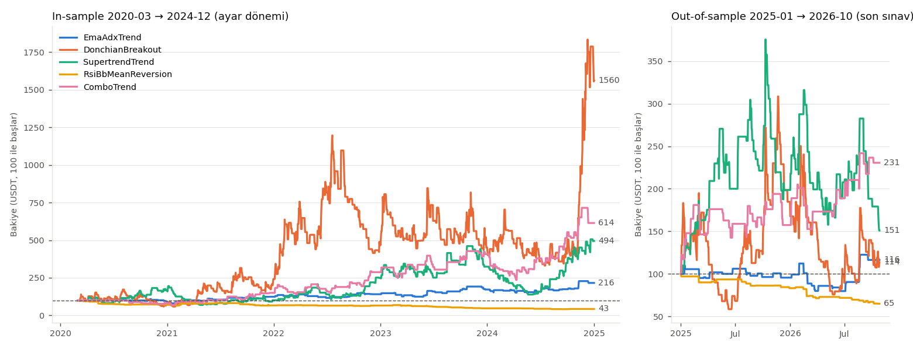
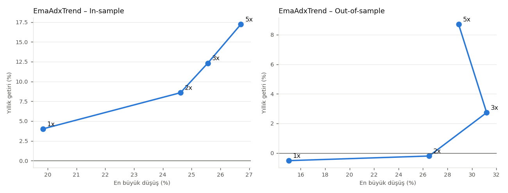
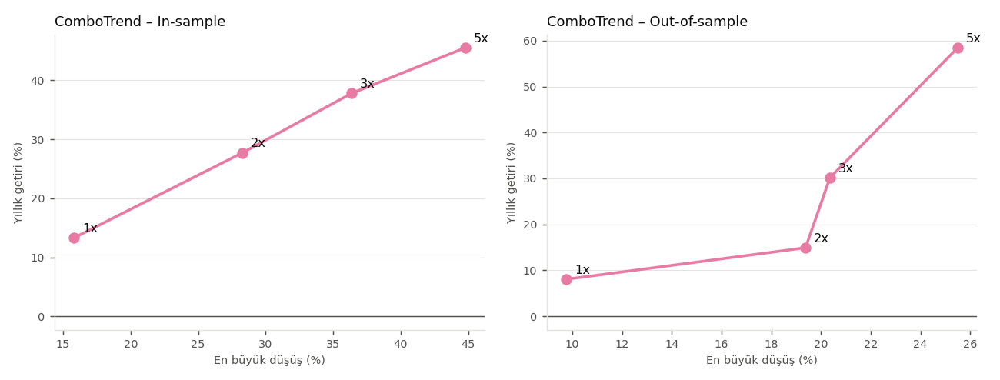
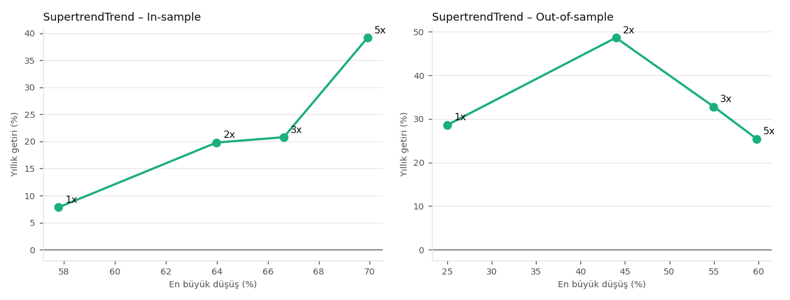

# Strateji Turnuvası (Aşama 3)

_Otomatik üretildi: `user_data/tools/tournament/report.py`. Veri: Binance USDⓈ-M, ETH, SOL, XRP, BNB, DOGE, ADA._

## Sonuç (önce bunu oku)

**Önceden sabitlenen kurallara göre seçilen strateji: `EmaAdxTrend`**, ATR stop çarpanı **3.0**,
çıkış modu **takip eden stop**, kaldıraç **5x**. Beş stratejiden kuralların hepsini geçen tek strateji bu.

**Dürüst değerlendirmem: kuralları geçti ama zar zor ve kırılgan.** Bunu "sağlam, güvenilir bir
kazanç makinesi bulduk" diye okuma. Gerçek parayla kullanmadan önce dry-run (sanal işlem) şart;
kâr edip etmediğini görmek için 4 hafta da yetmeyecek (aşağıya bak).

### Neden kazandı?
- **Tek bir şanslı ayara bağlı değil:** 8 varyantın (ATR 1.5 / 2 / 2.5 / 3 × takip eden stop /
  sabit kâr al) 7'si 2020-2024'te kârlı. Kazanan Donchian ve Supertrend'de ise 8 varyanttan
  sadece 1'i belirgin şekilde kârlı. Bu, onların sonucunun büyük ihtimalle tesadüf olduğunu
  gösterir.
- **Düşüşleri en sınırlı strateji:** en büyük düşüş 2020-2024'te %27, 2025-2026'da %29.
  Diğer trend stratejilerinde bu %45-75.
- Long ve short işlemlerin ikisi de kârlı. İşlemler ortalama 4-5 gün açık kalıyor, yani
  gerçek swing trading.
- Stopların çok az bir kısmı "gürültü" (stop olup 48 saat içinde fiyatın girişe dönmesi):
  2025-2026'da 9 stoptan 0.

### Zayıf yanları (bilmen gerekenler)
1. **Getirisi düşük, riski görece yüksek.** 2025-2026'da 22 ayda **+%16** (yıllık ~%9), bu arada
   **%29 düşüş** yaşadı. Yani bir dönem 100 USDT'nin ~71'e indiğini görmeye hazır olmalısın.
2. **Sadece 5x'te kuralları geçiyor.** 3x'te son sınav kâr faktörü 1.07, 1x-2x'te ise
   2025-2026 sonucu ~%0. Avantajı ince: birkaç büyük kazançtan geliyor, küçük pozisyonlarda
   neredeyse kayboluyor.
3. **Çok az işlem:** ayda ~2 işlem. 2025-2026'da sadece 38 işlem (alt sınır 30). İstatistiksel
   güven düşük.
4. **Uzun süre yeni zirve yapmayabilir:** 2025-2026'da hesap **381 gün** bir önceki zirvenin
   altında kaldı ve dönem sonunda hâlâ altında. 2020-2024'te en uzun süre 331 gün.
5. **Sadece yükseliş aylarında para kazanıyor:** BTC'nin %10'dan fazla yükseldiği aylarda ortalama
   +%4.4/ay; düşüş ve yatay aylarda ortalama ~%0 (aylarının üçte ikisi zararda).
6. **En kötü seri:** 2020-2024'te 9, 2025-2026'da 8 işlem üst üste zarar. Walk-forward'da
   2024'ün ilk yarısı **-%35**.

### ComboTrend neden seçilmedi?
2025-2026 son sınavında en iyi sonucu ComboTrend verdi: **+%131**, en büyük düşüş %25, kâr faktörü 1.42.
Ama önceden sabitlediğimiz iki kuralı geçemedi:
- 2020-2024'te düşüşü %45 (sınır %40),
- 6 walk-forward penceresinin sadece 3'ü kârlı (biri **-%50**).

Son sınav sonucuna bakıp kuralı esnetirsem, bu tam da kaçınmamız gereken şey olur: sonuca göre
seçim yapmak. Bu yüzden onu **seçmiyorum.** Yine de istersen dry-run'da ikinci bir sanal bot
olarak sadece gözlem amaçlı çalıştırılabilir; Aşama 4'te gelecek veri onun için de yeni bir test olur.

### Diğer bulgular
- **ATR çarpanı:** trend stratejilerinde dar stop (1.5 × ATR) genelde kötü; fiyatın normal
  dalgalanmasıyla erken stop oluyor. 2.5-3.0 daha iyi sonuç verdi.
- **Takip eden stop mu, sabit kâr al mı:** net bir kazanan yok; strateji başına değişiyor
  (EmaAdx'te takip eden stop, Combo/Supertrend/Donchian'da sabit kâr al daha iyi). Bu yüzden her
  stratejide kendi in-sample sonucuna göre seçildi.
- **Ortalamaya dönüş (RsiBb)** her dönemde ve her varyantta zararda. Bu coinlerde ve bu
  maliyetlerle işe yaramıyor.
- **Kaldıraç:** bu risk kurallarıyla kaldıraç düşürmek her işlemin riskini de düşürüyor
  (aynı %25 marjinle daha küçük pozisyon). 1x'te bütün stratejiler çok daha sakin ama getirisi de
  çok düşük. Ayrıntı Bölüm 6'da.

### Aşama 4 için önemli bir gerçek
EmaAdxTrend ayda ~2 işlem açıyor. **4 haftalık bir dry-run'da sadece 1-3 işlem olur.** Bu kadar
işlemle "kârlı mı" sorusunun cevabı istatistiksel olarak anlamsızdır. 4 haftalık dry-run sadece
**teknik doğrulama** için iyidir: emirler doğru açılıyor mu, stop Binance'te duruyor mu,
yeniden başlatmada sorun var mı, işlemler backtestteki kurallara uyuyor mu. Kârlılık hakkında
fikir edinmek için en az 3-6 ay gerekir.

---

## 1. Karşılaştırma tablosu

Sıralama: önce eleme kurallarını geçenler, sonra **sağlamlık puanı** (toplam kâra göre değil). In-sample ve out-of-sample ayrı koşulardır, ikisi de 100 USDT ile başlar.

| Strateji | Varyant | IS işlem | IS getiri | IS max düşüş | IS kâr fakt. | OOS işlem | OOS getiri | OOS max düşüş | OOS Calmar | OOS kâr fakt. | WF kârlı pencere | Puan | Geçti |
|---|---|---|---|---|---|---|---|---|---|---|---|---|---|
| **EmaAdxTrend** | atr3.0_trailing | 129 | 116% | 27% | 1.41 | 38 | 16% | 29% | 0.30 | 1.20 | 4/6 | 0.34 | ✅ |
| **ComboTrend** | atr2.0_fixed_tp | 210 | 514% | 45% | 1.39 | 70 | 131% | 25% | 2.29 | 1.42 | 3/6 | 0.63 | ❌ |
| **SupertrendTrend** | atr3.0_fixed_tp | 391 | 394% | 70% | 1.19 | 161 | 51% | 60% | 0.43 | 1.05 | 5/6 | 0.34 | ❌ |
| **DonchianBreakout** | atr1.5_fixed_tp | 989 | 1455% | 72% | 1.12 | 369 | 14% | 75% | 0.10 | 1.01 | 3/6 | 0.13 | ❌ |
| **RsiBbMeanReversion** | atr1.5_trailing | 111 | -57% | 59% | 0.48 | 42 | -35% | 35% | -0.60 | 0.22 | 1/6 | 0.03 | ❌ |

**Eleme sebepleri:**

- **EmaAdxTrend**: hiçbiri, tüm şartları geçti
- **ComboTrend**: en büyük düşüş çok fazla (45% > 40%); walk-forward tutarsız (3/6 pencere kârlı < 4)
- **SupertrendTrend**: out-of-sample kâr faktörü düşük (1.05 < 1.1); en büyük düşüş çok fazla (70% > 40%)
- **DonchianBreakout**: out-of-sample kâr faktörü düşük (1.01 < 1.1); en büyük düşüş çok fazla (75% > 40%); walk-forward tutarsız (3/6 pencere kârlı < 4)
- **RsiBbMeanReversion**: out-of-sample zararda (-35.1%); out-of-sample kâr faktörü düşük (0.22 < 1.1); en büyük düşüş çok fazla (59% > 40%); walk-forward tutarsız (1/6 pencere kârlı < 4)

## 2. Bakiye eğrileri

Sağdaki son sınav (out-of-sample) dönemi, stratejilerin ayar yapılırken hiç görmediği veridir. Eğriler sadece kapanmış işlemleri içerir.

## 3. Walk-forward (24 ay ayarla → sonraki 6 ayda test et)

| Strateji | 2022-01→2022-07 | 2022-07→2023-01 | 2023-01→2023-07 | 2023-07→2024-01 | 2024-01→2024-07 | 2024-07→2025-01 |
|---|---|---|---|---|---|---|
| EmaAdxTrend | -10% (10) | +28% (31) | +13% (15) | +9% (18) | -35% (33) | +6% (16) |
| DonchianBreakout | +85% (91) | +1% (72) | -20% (77) | +16% (85) | -42% (70) | -45% (70) |
| SupertrendTrend | +64% (52) | +45% (39) | +10% (48) | +10% (34) | -31% (46) | +252% (54) |
| RsiBbMeanReversion | +9% (15) | -4% (16) | -23% (28) | -16% (11) | -0% (8) | -4% (7) |
| ComboTrend | +74% (74) | +36% (86) | -20% (87) | -50% (52) | -2% (32) | +62% (25) |

Her hücre: o 6 aylık test penceresinin getirisi (işlem sayısı). Her pencere 100 USDT ile başlar ve parametreler sadece önceki 24 ayda ayarlanmıştır.

## 4. Piyasa dönemlerine göre (yükseliş / düşüş / yatay)

Ay sınıflandırması BTC'nin aylık getirisine göre: > +%10 yükseliş, < -%10 düşüş, arası yatay. Hücre: o tür aylarda stratejinin ortalama aylık getirisi.

| Strateji | Yükseliş ayları (27) | Düşüş ayları (16) | Yatay aylar (37) |
|---|---|---|---|
| EmaAdxTrend | +4.4% (52% ay kârlı) | +0.1% (38% ay kârlı) | +0.0% (34% ay kârlı) |
| DonchianBreakout | +15.8% (48% ay kârlı) | +12.5% (69% ay kârlı) | +0.9% (39% ay kârlı) |
| SupertrendTrend | +4.8% (59% ay kârlı) | +10.4% (62% ay kârlı) | +1.7% (50% ay kârlı) |
| RsiBbMeanReversion | -0.5% (22% ay kârlı) | -1.4% (38% ay kârlı) | -2.2% (16% ay kârlı) |
| ComboTrend | +4.5% (52% ay kârlı) | +11.5% (69% ay kârlı) | +1.2% (42% ay kârlı) |

## 5. ATR stop çarpanı ve çıkış modu (sadece in-sample)

Varyant seçimi **sadece in-sample** puanıyla yapıldı (out-of-sample'a bakılmadan).

**EmaAdxTrend**

| Varyant | İşlem | Getiri | Max düşüş | Calmar | Kâr fakt. | IS puanı |
|---|---|---|---|---|---|---|
| atr1.5_fixed_tp | 137 | 103% | 42% | 0.37 | 1.16 | 0.14 |
| atr1.5_trailing | 138 | -41% | 55% | -0.19 | 0.83 | 0.00 |
| atr2.0_fixed_tp | 133 | 133% | 40% | 0.47 | 1.27 | 0.20 |
| atr2.0_trailing | 135 | 48% | 42% | 0.20 | 1.13 | 0.09 |
| atr2.5_fixed_tp | 127 | 44% | 46% | 0.17 | 1.14 | 0.08 |
| atr2.5_trailing | 132 | 80% | 30% | 0.43 | 1.24 | 0.23 |
| atr3.0_fixed_tp | 125 | 92% | 37% | 0.39 | 1.26 | 0.19 |
| **→ atr3.0_trailing** | 129 | 116% | 27% | 0.65 | 1.41 | 0.35 |

**DonchianBreakout**

| Varyant | İşlem | Getiri | Max düşüş | Calmar | Kâr fakt. | IS puanı |
|---|---|---|---|---|---|---|
| **→ atr1.5_fixed_tp** | 989 | 1455% | 72% | 1.05 | 1.12 | 0.30 |
| atr1.5_trailing | 920 | -96% | 98% | -0.49 | 0.85 | 0.00 |
| atr2.0_fixed_tp | 756 | -69% | 95% | -0.22 | 0.96 | 0.00 |
| atr2.0_trailing | 960 | -82% | 95% | -0.31 | 0.93 | 0.00 |
| atr2.5_fixed_tp | 738 | 187% | 85% | 0.29 | 1.04 | 0.08 |
| atr2.5_trailing | 815 | -89% | 95% | -0.38 | 0.89 | 0.00 |
| atr3.0_fixed_tp | 663 | 18% | 85% | 0.04 | 1.01 | 0.01 |
| atr3.0_trailing | 787 | -7% | 73% | -0.02 | 1.00 | 0.00 |

**SupertrendTrend**

| Varyant | İşlem | Getiri | Max düşüş | Calmar | Kâr fakt. | IS puanı |
|---|---|---|---|---|---|---|
| atr1.5_fixed_tp | 525 | -77% | 92% | -0.28 | 0.89 | 0.00 |
| atr1.5_trailing | 589 | -93% | 95% | -0.44 | 0.82 | 0.00 |
| atr2.0_fixed_tp | 476 | -12% | 75% | -0.04 | 0.99 | 0.00 |
| atr2.0_trailing | 541 | -86% | 93% | -0.36 | 0.89 | 0.00 |
| atr2.5_fixed_tp | 424 | -26% | 76% | -0.08 | 0.97 | 0.00 |
| atr2.5_trailing | 497 | -56% | 82% | -0.19 | 0.94 | 0.00 |
| **→ atr3.0_fixed_tp** | 391 | 394% | 70% | 0.56 | 1.19 | 0.20 |
| atr3.0_trailing | 457 | -63% | 82% | -0.22 | 0.89 | 0.00 |

**RsiBbMeanReversion**

| Varyant | İşlem | Getiri | Max düşüş | Calmar | Kâr fakt. | IS puanı |
|---|---|---|---|---|---|---|
| atr1.5_fixed_tp | 109 | -33% | 42% | -0.19 | 0.78 | 0.00 |
| **→ atr1.5_trailing** | 111 | -57% | 59% | -0.27 | 0.48 | 0.00 |
| atr2.0_fixed_tp | 109 | -40% | 44% | -0.23 | 0.73 | 0.00 |
| atr2.0_trailing | 109 | -63% | 64% | -0.29 | 0.47 | 0.00 |
| atr2.5_fixed_tp | 109 | -42% | 46% | -0.23 | 0.71 | 0.00 |
| atr2.5_trailing | 109 | -49% | 51% | -0.25 | 0.64 | 0.00 |
| atr3.0_fixed_tp | 109 | -45% | 50% | -0.23 | 0.67 | 0.00 |
| atr3.0_trailing | 109 | -48% | 52% | -0.25 | 0.63 | 0.00 |

**ComboTrend**

| Varyant | İşlem | Getiri | Max düşüş | Calmar | Kâr fakt. | IS puanı |
|---|---|---|---|---|---|---|
| atr1.5_fixed_tp | 213 | 104% | 52% | 0.31 | 1.10 | 0.10 |
| atr1.5_trailing | 217 | -24% | 57% | -0.10 | 0.94 | 0.00 |
| **→ atr2.0_fixed_tp** | 210 | 514% | 45% | 1.02 | 1.39 | 0.37 |
| atr2.0_trailing | 214 | 59% | 48% | 0.21 | 1.10 | 0.08 |
| atr2.5_fixed_tp | 205 | 177% | 46% | 0.51 | 1.26 | 0.21 |
| atr2.5_trailing | 210 | 114% | 38% | 0.45 | 1.19 | 0.18 |
| atr3.0_fixed_tp | 202 | 119% | 45% | 0.39 | 1.23 | 0.17 |
| atr3.0_trailing | 208 | 116% | 43% | 0.40 | 1.21 | 0.16 |

Ortalama IS puanı: takip eden stop **0.05**, sabit kâr al **0.10**.

## 6. Kaldıraç taraması (en yüksek puanlı 2 strateji)

Risk kuralları aynı (işlem başına en fazla %5 kayıp, en fazla %25 marjin). Düşük kaldıraçta aynı marjinle daha küçük pozisyon açılabildiği için risk de küçülür.

**EmaAdxTrend**

| Kaldıraç | IS işlem | IS getiri | IS max düşüş | IS Calmar | OOS işlem | OOS getiri | OOS max düşüş | OOS Calmar |
|---|---|---|---|---|---|---|---|---|
| 1x | 129 | 21% | 20% | 0.20 | 36 | -1% | 15% | -0.03 |
| 2x | 129 | 49% | 25% | 0.35 | 38 | -0% | 26% | -0.01 |
| 3x | 129 | 75% | 26% | 0.48 | 38 | 5% | 31% | 0.09 |
| 5x | 129 | 116% | 27% | 0.65 | 38 | 16% | 29% | 0.30 |

**ComboTrend**

| Kaldıraç | IS işlem | IS getiri | IS max düşüş | IS Calmar | OOS işlem | OOS getiri | OOS max düşüş | OOS Calmar |
|---|---|---|---|---|---|---|---|---|
| 1x | 211 | 83% | 16% | 0.84 | 73 | 15% | 10% | 0.83 |
| 2x | 211 | 227% | 28% | 0.98 | 73 | 29% | 19% | 0.77 |
| 3x | 211 | 371% | 36% | 1.04 | 73 | 61% | 20% | 1.48 |
| 5x | 210 | 514% | 45% | 1.02 | 70 | 131% | 25% | 2.29 |

**SupertrendTrend**

| Kaldıraç | IS işlem | IS getiri | IS max düşüş | IS Calmar | OOS işlem | OOS getiri | OOS max düşüş | OOS Calmar |
|---|---|---|---|---|---|---|---|---|
| 1x | 426 | 44% | 58% | 0.14 | 188 | 58% | 25% | 1.14 |
| 2x | 409 | 140% | 64% | 0.31 | 176 | 105% | 44% | 1.11 |
| 3x | 397 | 149% | 67% | 0.31 | 167 | 67% | 55% | 0.60 |
| 5x | 391 | 394% | 70% | 0.56 | 161 | 51% | 60% | 0.43 |

## 7. Ayrıntılı inceleme: zayıf yanlar

### EmaAdxTrend (atr3.0_trailing)

Parametreler (in-sample hyperopt): `{"adx_min": 29, "ema_fast": 15, "ema_slow": 77}`

**In-sample (2020-03 → 2024-12)**

- En uzun kayıp serisi: **9 işlem üst üste zarar**
- En büyük düşüş: **%26.7** (dip: 2021-01-15)
- Zirveden aşağıda kalınan en uzun süre: **331 gün** (dönem sonunda hâlâ zirvenin altında)
- Gürültü stopları: 20 stoptan **6** tanesinde (%30) fiyat 48 saat içinde giriş fiyatına geri döndü
- Long / short: long 54 işlem, +34.4 USDT, short 75 işlem, +81.4 USDT
- Coinler (en kötüden iyiye): XRP -9.6, DOGE -9.0, ADA +8.6, BNB +11.3, SOL +45.1, ETH +69.4
- Çıkış sebepleri: exit_signal 42 (-128.4 USDT), stop_loss 20 (-138.8 USDT), trailing_stop_loss 67 (+383.1 USDT)
- En kötü tek işlem: BNB short 2023-12-18, -9.46 USDT

**Out-of-sample (2025-01 → 2026-10)**

- En uzun kayıp serisi: **8 işlem üst üste zarar**
- En büyük düşüş: **%28.9** (dip: 2026-06-17)
- Zirveden aşağıda kalınan en uzun süre: **381 gün** (dönem sonunda hâlâ zirvenin altında)
- Gürültü stopları: 9 stoptan **0** tanesinde (%0) fiyat 48 saat içinde giriş fiyatına geri döndü
- Long / short: long 18 işlem, +5.6 USDT, short 20 işlem, +10.8 USDT
- Coinler (en kötüden iyiye): DOGE -5.6, SOL -2.6, ETH -1.7, ADA +5.8, BNB +9.1, XRP +11.4
- Çıkış sebepleri: exit_signal 12 (-36.0 USDT), stop_loss 9 (-46.7 USDT), trailing_stop_loss 17 (+99.1 USDT)
- En kötü tek işlem: DOGE short 2026-09-11, -6.14 USDT

### ComboTrend (atr2.0_fixed_tp)

Parametreler (in-sample hyperopt): `{"ema_fast": 15, "ema_slow": 77, "st_period": 18, "adx_min": 27, "st_multiplier": 3.9}`

**In-sample (2020-03 → 2024-12)**

- En uzun kayıp serisi: **7 işlem üst üste zarar**
- En büyük düşüş: **%44.8** (dip: 2024-04-09)
- Zirveden aşağıda kalınan en uzun süre: **336 gün** (dönem sonunda hâlâ zirvenin altında)
- Gürültü stopları: 95 stoptan **36** tanesinde (%38) fiyat 48 saat içinde giriş fiyatına geri döndü
- Long / short: long 93 işlem, +357.3 USDT, short 117 işlem, +156.8 USDT
- Coinler (en kötüden iyiye): ETH +2.4, DOGE +9.7, BNB +38.2, XRP +134.2, SOL +162.2, ADA +167.4
- Çıkış sebepleri: exit_signal 38 (-150.4 USDT), stop_loss 95 (-1135.9 USDT), take_profit 77 (+1800.5 USDT)
- En kötü tek işlem: DOGE short 2024-12-10, -35.93 USDT

**Out-of-sample (2025-01 → 2026-10)**

- En uzun kayıp serisi: **7 işlem üst üste zarar**
- En büyük düşüş: **%25.5** (dip: 2026-02-27)
- Zirveden aşağıda kalınan en uzun süre: **221 gün** (dönem sonunda hâlâ zirvenin altında)
- Gürültü stopları: 34 stoptan **15** tanesinde (%44) fiyat 48 saat içinde giriş fiyatına geri döndü
- Long / short: long 41 işlem, +85.7 USDT, short 29 işlem, +44.9 USDT
- Coinler (en kötüden iyiye): ADA -2.5, BNB -0.5, DOGE +24.3, ETH +30.3, SOL +33.1, XRP +45.8
- Çıkış sebepleri: exit_signal 6 (-14.8 USDT), stop_loss 34 (-290.1 USDT), take_profit 30 (+435.5 USDT)
- En kötü tek işlem: DOGE long 2026-09-03, -12.60 USDT

## 8. Yöntem

- **Dönemler:** in-sample 2020-03 → 2024-12 (ayar ve seçim), out-of-sample 2025-01 → 2026-10-26 (son sınav, ayarda hiç kullanılmadı).
- **Maliyet:** her alış ve satışta %0.1 (%0.05 Binance taker ücreti + %0.05 kayma payı). Funding ücretleri gerçek funding oranı geçmişinden hesaplandı.
- **Gerçekçilik:** 15 dakikalık detay mumlarla stop/takip eden stop dolumları simüle edildi; korumalar (cooldown, stoploss guard, max drawdown, low profit pairs) açık; en fazla 3 açık işlem; 100 USDT başlangıç.
- **Hyperopt:** sadece eğitim döneminde, strateji başına 2-3 parametre, 50 deneme, kayıp fonksiyonu CalmarHyperOptLoss, sabit rastgele tohum (42).
- **Varyantlar:** ATR stop çarpanı [1.5, 2.0, 2.5, 3.0] × çıkış modu (takip eden stop / sabit kâr al = 2R). Seçim sadece in-sample puanıyla.
- **Walk-forward:** 6 pencere; her birinde önceki 24 ayda ayar, sonraki 6 ayda test.
- **Eleme kuralları (sonuçlardan önce sabitlendi):** IS ≥ 100 işlem, OOS ≥ 30 işlem, OOS kârlı ve kâr faktörü ≥ 1.1, IS ve OOS max düşüş ≤ %40, walk-forward'da en az 4/6 kârlı pencere.
- **Puan (0-1):** %30 OOS Calmar, %20 OOS kâr faktörü, %20 walk-forward tutarlılığı, %15 max düşüş, %15 OOS/IS getiri oranı (bozulma).
- **Sınırlar:** Binance arşivinde SOL/XRP için 2022'de ~5 günlük veri boşluğu var; bakiye eğrisi açık işlemlerin anlık zararını içermez; geçmiş performans geleceği garanti etmez.
